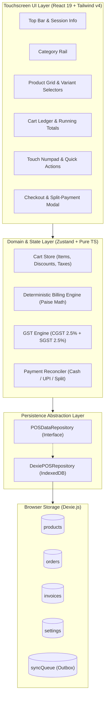
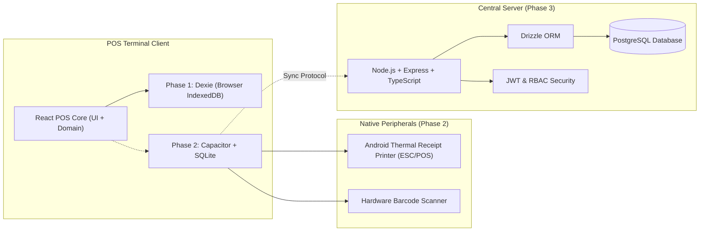

# Biryani POS — System Architecture & Integration Roadmap

## 1. Architectural Vision

Biryani POS is an offline-resilient, touch-optimized Point of Sale solution designed specifically for high-volume, rapid-turnaround biryani and quick-service restaurant (QSR) outlets.

The project follows a phased rollout strategy:

1. **Phase 1 (Current)**: Windows Browser Demo utilizing React 19, Vite, Tailwind CSS v4, and Dexie (IndexedDB) for local data persistence.
2. **Phase 2 (Future)**: Android Touchscreen POS Terminal deployment utilizing Capacitor, SQLite, and native thermal receipt printer bridges.
3. **Phase 3 (Future)**: Centralized cloud synchronization and management backend using Node.js, Express, TypeScript, and PostgreSQL with Drizzle ORM.

---

## 2. High-Level Architecture (Phase 1: Local Demo)



---

## 3. Financial & Billing Domain Principles

### 3.1 Strict Integer Paise Representation

To eliminate floating-point arithmetic errors inherent in JavaScript IEEE-754 double-precision numbers, all monetary values are processed and stored strictly as **integers in paise**:

- ₹1.00 = 100 paise.
- ₹240.50 = 24050 paise.

```
Subtotal (Paise) = Σ (Item.unitPricePaise * Item.quantity)
Discount (Paise) = FlatDiscountPaise OR Round((SubtotalPaise * DiscountPercent) / 100)
TaxableAmount (Paise) = Subtotal - Discount
CGST (Paise) = Round((TaxableAmount * 2.5) / 100)
SGST (Paise) = Round((TaxableAmount * 2.5) / 100)
GrandTotal (Paise) = TaxableAmount + CGST + SGST
```

### 3.2 Immutability of Completed Invoices

Once an invoice is finalized:

- An immutable snapshot is persisted to the `invoices` table.
- Product price changes or catalog deletions never alter historical invoices.
- Invoices cannot be modified or silently dropped.

---

## 4. Why Python, Django, and KOT Are Excluded

| Excluded Component              | Rationale                                                                                                                                                                                                                                                                                                                                                                                                           |
| :------------------------------ | :------------------------------------------------------------------------------------------------------------------------------------------------------------------------------------------------------------------------------------------------------------------------------------------------------------------------------------------------------------------------------------------------------------------ |
| **Python / Django / Flask**     | POS terminals require ultra-low latency, instant touch feedback, offline reliability, and minimal resource footprints. Introducing a Python interpreter or Django server creates unnecessary overhead, complex local runtime packaging, and sync impedance mismatch. A unified TypeScript stack across the client, native shell (Capacitor), and eventual backend (Node.js) maximizes code sharing and type safety. |
| **KOT (Kitchen Order Tickets)** | The target business model is high-speed biryani counters where items are portioned and fulfilled directly from the front counter upon ordering. Kitchen routing queues and kitchen displays introduce operational latency and user complexity not needed for this workflow.                                                                                                                                         |

---

## 5. Future Integration Roadmap & Boundaries



### 5.1 Phase 2: Android Hardware Migration (Capacitor + SQLite)

- **Repository Swap**: Replace `DexiePOSRepository` with `CapacitorSQLiteRepository` implementing the identical `POSDataRepository` interface.
- **Thermal Printing**: Implement native ESC/POS thermal printing using USB/Bluetooth serial drivers or Android POS SDKs (Sunmi / IMin / Pax).
- **Physical Device Lockdown**: Configure Android Kiosk mode (device owner / pin-to-screen).

### 5.2 Phase 3: Cloud Synchronization & Central Backend

- **Backend Stack**: Node.js + Express + TypeScript + PostgreSQL + Drizzle ORM.
- **Offline Sync Protocol**: Terminals push unsynced items from `syncQueue` when network connectivity is established, utilizing vector clocks and idempotent transaction UUIDs to guarantee zero duplicate charges.
- **Production Payment Verification**: Server-side webhook verification for payment gateways (Razorpay / PineLabs / Paytm) with digital signature validation.
